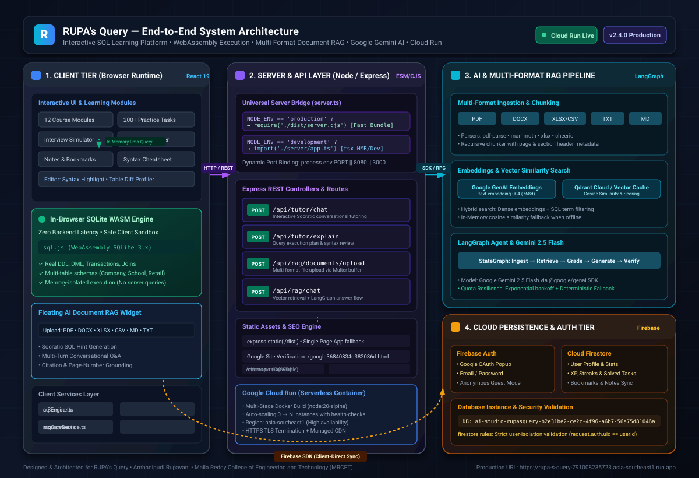
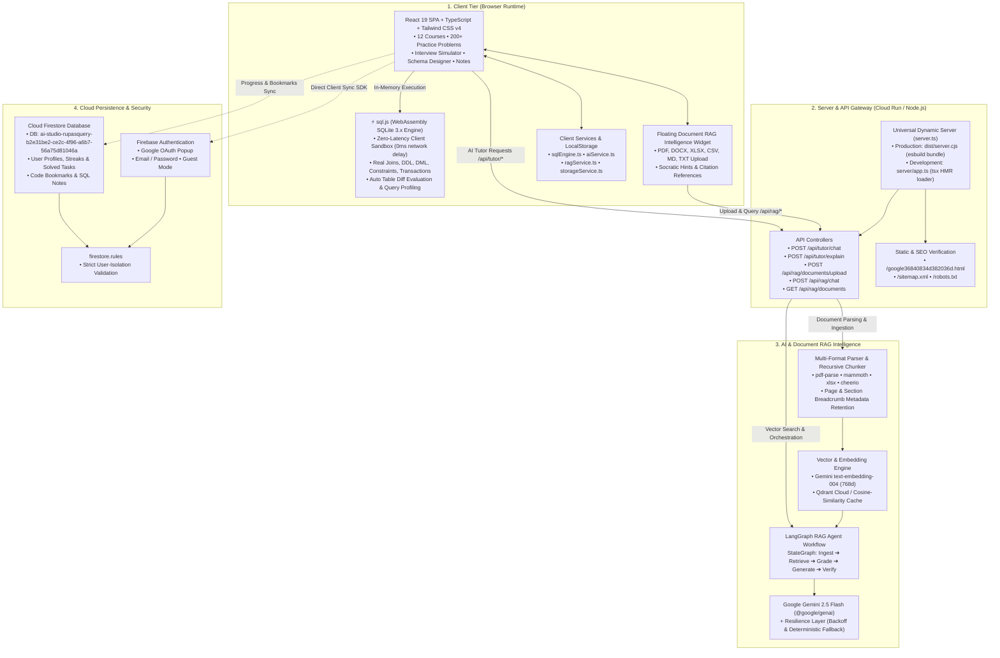

# RUPA's Query — Interactive SQL Learning & Accuracy-Focused Document RAG Intelligence Platform

<p align="center">
  
</p>

<p align="center">
  <a href="https://rupa-s-query-791008235723.asia-southeast1.run.app/"></a>
  <a href="https://ais-dev-z2h4bofprah275lmufmu3s-460816146050.asia-southeast1.run.app"></a>
  
  
  
  
  
  
</p>

---

## 📌 Table of Contents
1. [Project Overview](#-project-overview)
2. [Problem Statement & Core Innovations](#-problem-statement--core-innovations)
3. [Key Features](#-key-features)
   - [Accuracy-Focused Document RAG Assistant](#1-accuracy-focused-document-rag-assistant)
   - [Interactive SQL Education Platform](#2-interactive-sql-education-platform)
4. [Technology Stack](#-technology-stack)
5. [System Architecture](#-system-architecture)
   - [End-to-End System Diagram](#end-to-end-system-diagram)
   - [The 12-Stage LangGraph RAG Pipeline](#the-12-stage-langgraph-rag-pipeline)
   - [WebAssembly In-Browser SQL Execution](#webassembly-in-browser-sql-execution)
6. [Project Repository Structure](#-project-repository-structure)
7. [Installation and Local Setup](#-installation-and-local-setup)
8. [Environment Configuration](#-environment-configuration)
9. [How to Run the Application](#-how-to-run-the-application)
10. [How to Use the RAG Assistant](#-how-to-use-the-rag-assistant)
11. [Visual Assets & Screenshots](#-visual-assets--screenshots)
12. [Troubleshooting & FAQs](#-troubleshooting--faqs)
13. [Future Enhancements](#-future-enhancements)
14. [Author & Acknowledgments](#-author--acknowledgments)
15. [License](#-license)

---

## 📖 Project Overview

**RUPA's Query** is a full-stack, enterprise-grade educational ecosystem and artificial intelligence platform architected and developed by **Ambadipudi Rupavani** (Computer Science & Engineering student at *Malla Reddy College of Engineering and Technology - MRCET*).

The platform pairs a zero-latency, in-browser **WebAssembly SQL execution engine** with an **accuracy-first Document Retrieval-Augmented Generation (RAG) assistant**. Learners and database engineers can practice SQL through 12 structured curriculum courses, solve 200+ auto-validated challenges, simulate real-world technical interviews, design schemas visually, and query their own uploaded technical documentation (PDF, Word, Excel, CSV, Markdown, Text) with source-verified citations and zero hallucinations.

### 🔗 Live URLs
- **Production URL (Google Cloud Run):** [https://rupa-s-query-791008235723.asia-southeast1.run.app/](https://rupa-s-query-791008235723.asia-southeast1.run.app/)
- **Interactive Dev Preview:** [https://ais-dev-z2h4bofprah275lmufmu3s-460816146050.asia-southeast1.run.app](https://ais-dev-z2h4bofprah275lmufmu3s-460816146050.asia-southeast1.run.app)
- **Shared Preview:** [https://ais-pre-z2h4bofprah275lmufmu3s-460816146050.asia-southeast1.run.app](https://ais-pre-z2h4bofprah275lmufmu3s-460816146050.asia-southeast1.run.app)

---

## 🎯 Problem Statement & Core Innovations

### The Educational Problem
Traditional online database learning platforms route every student's experimental `SELECT`, `UPDATE`, or `JOIN` statement to a shared fleet of cloud database servers. This introduces:
1. **Network Latency:** 200ms–1500ms execution round-trips for every simple query run.
2. **Server Resource Exhaustion:** Runaway Cartesian joins (`CROSS JOIN`) or infinite recursive common table expressions (`WITH RECURSIVE`) can lock database threads and trigger system outages.
3. **Escalating Cloud Costs:** Server compute scales linearly with user concurrency.
4. **Untrusted AI Hallucinations:** Generic AI chatbots frequently invent non-existent SQL syntax, reference columns that do not exist in the active schema, or provide answers unsupported by course documentation.

### The RUPA's Query Solution
1. **Client-Side Edge WebAssembly Sandbox (`sql.js`):** Relational database execution runs 100% inside the user's browser memory via WebAssembly SQLite 3.x. Latency is **0ms**, zero server compute is spent on student queries, and student databases remain isolated and secure.
2. **LangGraph-Orchestrated Multi-Format RAG:** Uploaded documents are parsed, chunked with page and section preservation, embedded into 768-dimensional dense vectors using Google Gemini `text-embedding-004`, and indexed into **Qdrant Cloud**. A 12-stage LangGraph workflow validates context relevance and performs strict hallucination checks before serving answers.
3. **Dual-Mode AI Interaction:** Supports both **Direct Evidence Mode** (fact-based query answering grounded in uploaded files) and **Socratic SQL Mode** (pedagogical hints that guide learners toward the solution without spoiling answers).
4. **Production Rate-Limit Resilience:** Features exponential backoff with jitter and an automated fallback to a deterministic SQL rule base if Google Gemini free-tier rate limits (HTTP 429) are reached, ensuring uninterrupted uptime.

---

## ✨ Key Features

### 1. Accuracy-Focused Document RAG Assistant
*Implemented in `server/rag/*` and `src/components/rag/FloatingRagAssistant.tsx`*

- **Non-Intrusive Floating Widget:** Resides as a floating brain icon in the bottom-right corner. Opens strictly on user click and never disrupts the learning canvas.
- **Multi-Format Document Upload:**
  - 📄 **PDF (`.pdf`):** Extracts multi-page text using `pdf-parse`, preserving accurate page numbers for source citations.
  - 📝 **Word Documents (`.docx`):** Parses hierarchical headings, lists, and paragraphs using `mammoth`.
  - 📊 **Excel Spreadsheets (`.xlsx`):** Ingests multi-sheet workbooks using `xlsx`, retaining sheet names and row/column coordinates.
  - 📑 **CSV Files (`.csv`):** Parses tabular records using `csv-parse`, capturing table headers and record values.
  - 📘 **Markdown (`.md`):** Parses code blocks, headers, and bullet lists.
  - 📋 **Plain Text (`.txt`):** Ingests raw technical notes.
- **Context-Aware Semantic Chunking (`chunker.ts`):** Recursive character text splitter (800-character chunks with 150-character token overlap) retaining document ID, page numbers, section headers, and file origins.
- **Dense Vector Embeddings (`embeddings.ts`):** Google Gemini `text-embedding-004` producing 768-dimensional normalized dense vectors.
- **Qdrant Cloud & Hybrid Vector Search (`vectorStore.ts`):** Indexes vectors into the `rupas_query_documents` collection using Cosine distance. Employs a hybrid scoring algorithm combining dense vector similarity with lexical term matching, with automatic fallback to a high-speed in-memory vector cache if offline.
- **LangGraph StateGraph Workflow (`langgraphRag.ts`):** Orchestrates multi-step reasoning: query rewriting, relevance grading, reranking, context formatting, evidence generation, hallucination verification, and citation validation.
- **Source Verification & Grounded Citations:** Clickable citation drawer displays document name, page number, sheet name, snippet excerpts, and mathematical relevance scores.

### 2. Interactive SQL Education Platform
*Implemented in `src/pages/*` and `src/services/sqlEngine.ts`*

- **In-Browser WebAssembly Engine:** Full relational support for DDL, DML, foreign key constraints, primary keys, transactions, and analytical window functions (`ROW_NUMBER`, `RANK`, `DENSE_RANK`, `LEAD`, `LAG`).
- **12 Structured Courses:** Curriculum spanning relational algebra, filtering, multi-table joins, aggregations, subqueries, CTEs, view creation, indexing, and normalization.
- **200+ Auto-Evaluated Practice Problems:** Categorized by Beginner, Intermediate, and Advanced. Executes student queries against reference solutions and displays side-by-side table diffs.
- **Technical Interview Simulator:** 60+ real interview challenges from top technology companies featuring an integrated countdown timer, difficulty tags, and step-by-step hints.
- **Visual Schema Designer:** Interactive entity-relationship (ER) modeler and database schema visualizer.
- **Personal Notebook & Bookmarks:** Integrated code notepad for saving custom snippets and bookmarking challenging problems.
- **Cloud Progress Synchronization:** Firebase Authentication (Google OAuth popup, Email/Password, Guest mode) and Cloud Firestore syncing user XP, streaks, and completed problems.

---

## 💻 Technology Stack

### Frontend Architecture
- **Framework:** React 19 (`react: 19.0.1`, `react-dom: 19.0.1`)
- **Language:** TypeScript 5.8 (`typescript: ~5.8.2`)
- **Build Tool & Bundler:** Vite 6 (`vite: ^6.2.3`, `@vitejs/plugin-react: ^5.0.4`)
- **Styling:** Tailwind CSS v4 (`tailwindcss: ^4.1.14`, `@tailwindcss/vite: ^4.1.14`)
- **Icons:** Lucide React (`lucide-react: ^0.546.0`)
- **Animations:** Motion (`motion: ^12.23.24`)
- **Data Visualization:** Recharts (`recharts: ^3.10.1`)
- **Celebration Effects:** Canvas Confetti (`canvas-confetti: ^1.9.4`, `@types/canvas-confetti: ^1.9.0`)
- **Markdown Rendering:** React Markdown (`react-markdown: ^10.1.0`)

### In-Browser Database Sandbox
- **Engine:** `sql.js: ^1.14.2` (SQLite 3.x compiled to WebAssembly)
- **Binary:** Pre-compiled `public/sql-wasm.wasm` loaded in client memory

### Backend & API Gateway
- **Runtime:** Node.js 20 LTS
- **Framework:** Express.js (`express: ^4.21.2`, `@types/express: ^4.17.21`)
- **Development Loader:** `tsx: ^4.21.0` (Native TypeScript execution with hot reload)
- **Production Bundler:** `esbuild: ^0.25.0` (Compiles `server/app.ts` into standalone `dist/server.cjs`)
- **Multipart Uploads:** Multer (`multer: ^2.5.0`, `@types/multer: ^2.3.0`)
- **Environment Management:** Dotenv (`dotenv: ^17.2.3`)

### Artificial Intelligence & RAG
- **LLM:** Google Gemini 2.5 Flash
- **GenAI SDK:** `@google/genai: ^2.4.0` (Official Google GenAI TypeScript SDK)
- **Embedding Model:** Google Gemini `text-embedding-004` (768 Dimensions)
- **RAG Orchestration:** LangGraph (`@langchain/langgraph: ^1.6.0`, `@langchain/core: ^1.3.4`)
- **Vector Database:** Qdrant Cloud (`@qdrant/js-client-rest: ^1.20.0`)
- **Document Parsers:**
  - PDF: `pdf-parse: ^2.4.5`
  - Word: `mammoth: ^1.13.0`
  - Excel: `xlsx: ^0.18.5`
  - CSV: `csv-parse: ^7.0.3`
  - HTML / Markup: `cheerio: ^1.2.0`

### Cloud Persistence & Security
- **Authentication:** Firebase Auth (`firebase: ^12.18.0`)
- **Database:** Google Cloud Firestore (Instance: `ai-studio-rupasquery-b2e31be2-ce2c-4f96-a6b7-56a75d81046a`)
- **Security Validation:** `firestore.rules` (Strict user data isolation enforced at database engine level)

### Production Deployment
- **Containerization:** Multi-stage Docker image based on `node:20-alpine`
- **Cloud Platform:** Google Cloud Run (Region: `asia-southeast1`, autoscaling 0 to N instances)

---

## 🏗️ System Architecture

### End-to-End System Diagram



### The 12-Stage LangGraph RAG Pipeline
*Orchestrated by `server/rag/langgraphRag.ts`*

```
User Query
   │
   ▼
[1. query_analyzer] ────────── Analyzes user intent, question type, and conversation context.
   │
   ▼
[2. query_rewriter] ────────── Resolves conversational coreferences into a standalone search query.
   │
   ▼
[3. document_retriever] ────── Generates 768d query embedding via Gemini text-embedding-004;
   │                           performs hybrid search against Qdrant Cloud (vector + keyword).
   ▼
[4. relevance_grader] ──────── Filters candidate chunks based on cosine similarity thresholds.
   │
   ├─► (If top chunks < threshold & retries < 2) ──► [5. retrieval_retry] ──► (Rewrites & re-queries)
   │
   ▼
[6. reranker] ──────────────── Recalculates final hybrid scores and selects top 5 evidence chunks.
   │
   ▼
[7. context_builder] ───────── Structures retrieved chunks into markdown with page and section metadata.
   │
   ▼
[8. gemini_generator] ──────── Calls Gemini 2.5 Flash to synthesize response strictly grounded in context.
   │
   ▼
[9. answer_verifier] ───────── Cross-checks generated assertions against context to prevent hallucinations.
   │
   ▼
[10. citation_validator] ───── Maps and verifies citations, attaching snippets, page numbers, and scores.
   │
   ▼
[11. response_formatter] ───── Formats final verified answer with interactive citation metadata.
   │
   ▼
Client Receives Evidence-Grounded Answer + Clickable Citations
```

---

## 📁 Project Repository Structure

```
.
├── docs/                               # Architectural Diagrams & Technical Specs
│   ├── ARCHITECTURE.md                 # Exhaustive system architecture specifications
│   └── architecture-diagram.svg        # Standalone vector SVG system architecture diagram
├── public/                             # Public Static Assets
│   ├── architecture-diagram.svg        # Architecture diagram served in application UI
│   ├── rupavani_profile.jpg            # Author photograph
│   ├── sql-wasm.wasm                   # WebAssembly SQLite 3.x compiled binary
│   ├── sitemap.xml                     # Search engine optimization index
│   ├── robots.txt                      # Crawler index directives
│   └── google36840834d382036d.html     # Google Search Console domain verification
├── server/                             # Server-Side Implementation & RAG Pipeline
│   ├── app.ts                          # Express application setup, routes & middleware
│   └── rag/                            # Accuracy-Focused Document RAG Engine
│       ├── chunker.ts                  # Recursive character splitter with metadata
│       ├── embeddings.ts               # Gemini text-embedding-004 (768d) generation
│       ├── evaluator.ts                # Relevance grader & hallucination detection
│       ├── geminiResilience.ts         # Quota backoff & deterministic fallback engine
│       ├── langgraphRag.ts             # 12-stage LangGraph StateGraph orchestration
│       ├── parsers.ts                  # Multi-format parsers (PDF, DOCX, XLSX, CSV, TXT, MD)
│       ├── seed.ts                     # Pre-seeded SQL Mastery Guide document ingestion
│       ├── storage.ts                  # Document file storage & metadata indexing
│       ├── types.ts                    # TypeScript data contracts for RAG documents & chunks
│       └── vectorStore.ts              # Qdrant Cloud client & in-memory vector cache
├── src/                                # Frontend React 19 Application
│   ├── components/                     # Modular Reusable UI Components
│   │   ├── ai/                         # SQL AI Tutor chat panel and hint cards
│   │   ├── editor/                     # SQL Editor, interactive table diff & profiler
│   │   ├── layout/                     # Header, navigation bar, footer & hero sections
│   │   ├── rag/                        # Floating Document RAG Assistant
│   │   │   └── FloatingRagAssistant.tsx# Multi-format uploader, chat & citation drawer
│   │   └── schema/                     # Interactive ER diagram and schema inspector
│   ├── context/                        # Global State Management
│   │   └── AppContext.tsx              # Auth session, XP, streaks, active problem, theme
│   ├── data/                           # Relational Curriculum & Problem Sets
│   │   ├── courses.ts                  # 12 structured curriculum courses with lessons
│   │   ├── practiceProblems.ts         # 200+ practice questions with test databases
│   │   └── interviewQuestions.ts       # 60+ technical interview scenarios
│   ├── pages/                          # Application Route Views
│   │   ├── LandingHome.tsx             # Interactive homepage with platform showcase
│   │   ├── CoursesView.tsx             # Curriculum browser & lesson viewer
│   │   ├── PracticeView.tsx            # Problem-solving workspace with table diffing
│   │   ├── SandboxView.tsx             # Free-form SQL scratchpad with sample databases
│   │   ├── InterviewPrepView.tsx       # Interview simulator with timer & hints
│   │   ├── CheatsheetView.tsx          # SQL syntax reference cards
│   │   ├── NotesView.tsx               # Personal notebook with Firestore sync
│   │   └── AboutAuthorView.tsx         # Author biography, credentials & career vision
│   ├── services/                       # Client Service Layer
│   │   ├── aiService.ts                # Client proxy for AI tutor endpoints
│   │   ├── firebase.ts                 # Firebase Auth & Firestore client SDK
│   │   ├── ragService.ts               # Document upload and RAG chat API client
│   │   ├── sqlEngine.ts                # sql.js WebAssembly loader & in-memory executor
│   │   └── storageService.ts           # Browser localStorage and state manager
│   ├── App.tsx                         # Primary routing & view switcher
│   ├── main.tsx                        # React application bootstrap
│   ├── types.ts                        # Shared frontend TypeScript interfaces
│   └── index.css                       # Global styling with Tailwind CSS v4
├── server.ts                           # Universal server entry point (production/dev bridge)
├── firestore.rules                     # Cloud Firestore security rules
├── firebase-applet-config.json         # Firebase project metadata
├── metadata.json                       # AI Studio applet manifest
├── Dockerfile                          # Multi-stage production container build
├── DEPLOYMENT.md                       # Comprehensive deployment guide for all clouds
├── vite.config.ts                      # Vite build configuration
├── tsconfig.json                       # TypeScript compiler configuration
└── package.json                        # Project dependencies, scripts & metadata
```

---

## 🚀 Installation and Local Setup

### 1. Prerequisites
Ensure your development environment meets the following requirements:
- **Node.js:** `v20.x` or `v22.x` LTS recommended (`v18.x` minimum)
- **Package Manager:** `npm` (v10+), `bun`, or `pnpm`
- **Git:** Latest version

### 2. Clone the Repository
```bash
git clone https://github.com/rupavani/rupas-query.git
cd rupas-query
```

### 3. Install Dependencies
Install all required runtime and development packages:
```bash
npm install
```

---

## 🔐 Environment Configuration

Create a `.env` file in the root directory by referencing the provided `.env.example`:

```bash
cp .env.example .env
```

### Environment Variables Matrix

| Variable | Required? | Default | Purpose |
| :--- | :--- | :--- | :--- |
| `PORT` | Optional | `3000` | Port for the Express server and development server (`8080` for Cloud Run). |
| `NODE_ENV` | Optional | `development` | Environment mode (`development` or `production`). |
| `GEMINI_API_KEY` | Recommended | None | Google Gemini API Key for AI tutoring, text generation, and embeddings. |
| `QDRANT_URL` | Optional | None | Qdrant Cloud cluster endpoint (e.g. `https://xxxxxx.us-east4-0.gcp.cloud.qdrant.io:6333`). |
| `QDRANT_API_KEY` | Optional | None | API Key for authenticating with Qdrant Cloud. |
| `APP_URL` | Optional | Injected | The hosting URL of the application. |

> **Graceful Fallbacks:**  
> - If `QDRANT_URL` is omitted, the application automatically initializes an in-memory vector store with cosine distance calculations.
> - If `GEMINI_API_KEY` is omitted or encounters a rate limit (HTTP 429), the application automatically engages its deterministic offline SQL rule engine, ensuring zero crashes.

---

## 🏃 How to Run the Application

### Development Mode
Runs the backend Express server with `tsx` hot reloading and mounts the Vite development server on port 3000:
```bash
npm run dev
```
Open **[http://localhost:3000](http://localhost:3000)** in your browser.

### Type Checking & Linting
Validate the codebase for missing imports, syntax errors, and type safety:
```bash
npm run lint
```

### Building for Production
Compiles the React frontend via Vite into `dist/` and bundles the backend server into a standalone CommonJS bundle (`dist/server.cjs`) via `esbuild`:
```bash
npm run build
```

### Starting the Production Server
Runs the compiled production server:
```bash
npm start
```

---

## 💬 How to Use the RAG Assistant

1. **Open the Assistant:** Click the floating brain icon in the bottom-right corner of any page.
2. **Upload Your Study Materials:**
   - Navigate to the **"Documents"** tab.
   - Click or drag-and-drop your file (`.pdf`, `.docx`, `.xlsx`, `.csv`, `.md`, or `.txt`).
   - The server will parse the content, extract structured sections, generate 768-dimensional embeddings, and store them in the vector database.
3. **Choose Your Mode:**
   - **Direct Mode:** Receives direct, factual answers grounded in the uploaded materials.
   - **Socratic Mode:** Receives progressive conceptual hints and guiding questions to learn database concepts without spoiling direct answers.
4. **Ask a Question:**
   - Type questions like:
     - *"What are the primary keys in the schema from chapter 3?"*
     - *"Explain how the foreign key constraint works in the uploaded document."*
     - *"Summarize the salary column statistics from the Excel spreadsheet."*
5. **Inspect Citations:**
   - Click the citation badges beneath any AI response to open the **Citation Drawer**.
   - Review the exact source file name, page number, slide/sheet name, snippet text, and relevance score.

---

## 🖼️ Visual Assets & Screenshots

### 1. End-to-End System Architecture Diagram
The high-resolution vector system architecture is permanently stored in the repository at `docs/architecture-diagram.svg` and `public/architecture-diagram.svg`:

<p align="center">
  
</p>

### 2. Platform Architect & Developer
<p align="center">
  
  <br/>
  <strong>Ambadipudi Rupavani</strong><br/>
  <em>Lead Architect & Software Engineer</em>
</p>

---

## 🛠️ Troubleshooting & FAQs

### 1. Gemini API Quota Exceeded (HTTP 429)
- **Symptom:** API logs display `429 RESOURCE_EXHAUSTED` or `Generate content requests per minute limit exceeded on Free Tier`.
- **Built-in Solution:** The platform includes an automatic resilience layer (`server/rag/geminiResilience.ts`). When a 429 is detected, the application automatically engages an offline deterministic rule-based SQL analysis engine. No crashes occur and learners receive structured feedback.

### 2. Qdrant Cloud Connection Failures
- **Symptom:** Network error connecting to external Qdrant URL.
- **Built-in Solution:** `server/rag/vectorStore.ts` detects external connection issues and automatically switches to the in-memory cosine similarity mirror. Document ingestion and vector similarity queries continue operating smoothly.

### 3. WebAssembly `sql.js` Initialization
- **Symptom:** `TypeError: Failed to fetch sql-wasm.wasm`.
- **Solution:** Ensure `public/sql-wasm.wasm` exists. Vite serves static files directly from `public/`. If running behind a reverse proxy, ensure the `.wasm` MIME type is configured as `application/wasm`.

### 4. Port Conflicts on Startup
- **Symptom:** `Error: listen EADDRINUSE: address already in use :::3000`.
- **Solution:** Another process is utilizing port 3000. Specify an alternative port:
  ```bash
  PORT=3001 npm run dev
  ```

---

## 🔮 Future Enhancements

- [ ] **OCR Engine Integration:** Add native Tesseract / Gemini Vision OCR for image-only scanned PDFs.
- [ ] **Direct SQL Execution over CSV/XLSX:** Automatically load uploaded CSV or Excel files as temporary SQLite tables in the in-browser WASM engine so users can write queries directly against their uploaded datasets.
- [ ] **Cross-Encoder Re-Ranking:** Incorporate advanced neural re-rankers (e.g. Cohere or BGE Reranker) into the LangGraph re-ranking node.
- [ ] **Collaborative Query Workspaces:** Multi-user live coding rooms via WebSockets.
- [ ] **Vector Export & Import:** Export vector collections as portable standalone embeddings packages.

---

## 👩‍💻 Author & Acknowledgments

- **Creator & Lead Engineer:** **Ambadipudi Rupavani**
- **Degree:** Bachelor of Technology in Computer Science & Engineering (B.Tech CSE)
- **Institution:** *Malla Reddy College of Engineering and Technology (MRCET)*, Hyderabad, Telangana, India
- **Email:** [sithaambadipudi5@gmail.com](mailto:sithaambadipudi5@gmail.com)
- **Phone:** +91 9701691282
- **Production Application:** [https://rupa-s-query-791008235723.asia-southeast1.run.app/](https://rupa-s-query-791008235723.asia-southeast1.run.app/)

Special thanks to the open-source communities behind **sql.js**, **React**, **LangGraph**, **Qdrant**, and **Google GenAI** for providing the foundational technologies that made this platform possible.

---

## 📄 License

This project is maintained as a proprietary educational and portfolio system (`"private": true` in `package.json`). All intellectual property, architectural designs, curriculum materials, and custom source code are authored by **Ambadipudi Rupavani**. 

For academic inquiries, collaborations, or enterprise demonstrations, please reach out via [sithaambadipudi5@gmail.com](mailto:sithaambadipudi5@gmail.com).

---

<p align="center">
  <em>Built with ❤️ and engineering excellence by Ambadipudi Rupavani at MRCET.</em>
</p>
