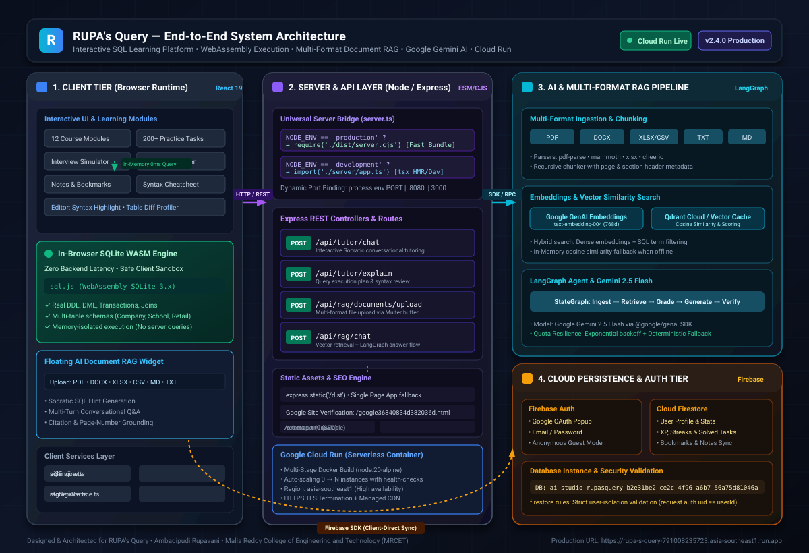
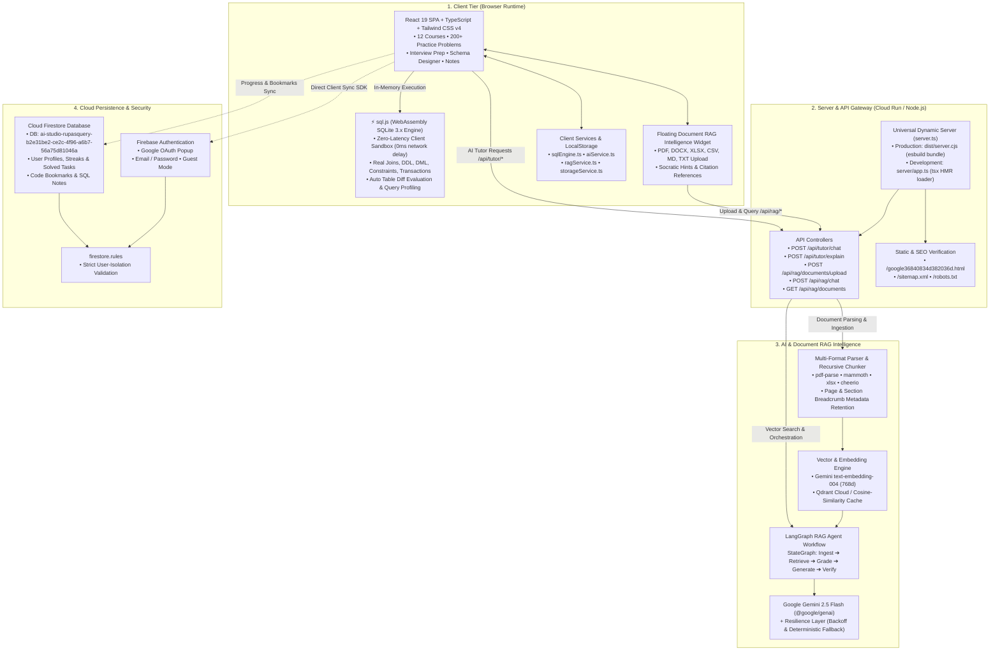
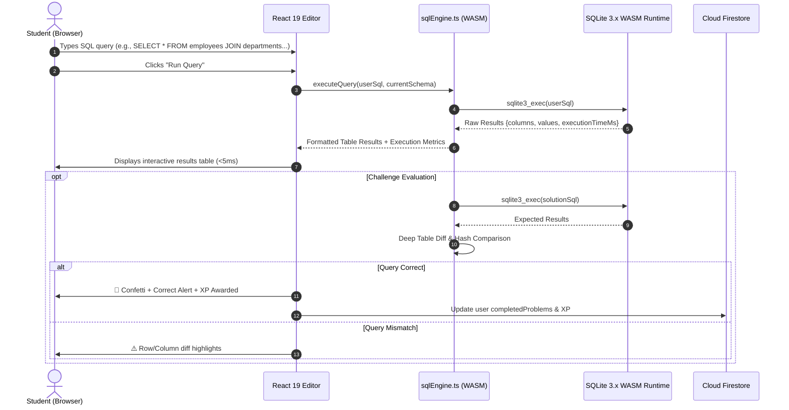
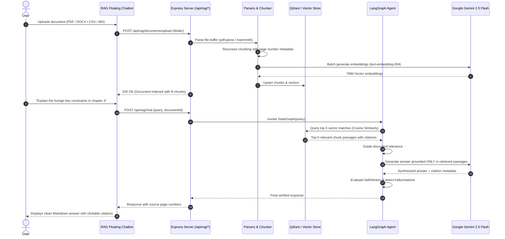

# System Architecture & Technical Specifications

## RUPA's Query — Interactive SQL Learning & Accuracy-Focused Document RAG Platform

**Architect & Lead Engineer:** Ambadipudi Rupavani  
**Institution:** Malla Reddy College of Engineering and Technology (MRCET)  
**Production URL:** [https://rupa-s-query-791008235723.asia-southeast1.run.app](https://rupa-s-query-791008235723.asia-southeast1.run.app)  
**Development URL:** [https://ais-dev-z2h4bofprah275lmufmu3s-460816146050.asia-southeast1.run.app](https://ais-dev-z2h4bofprah275lmufmu3s-460816146050.asia-southeast1.run.app)  
**Document Version:** `2.5.0` (Production Release)

---

## 1. Executive Summary & Design Philosophy

**RUPA's Query** solves the fundamental architectural bottleneck of interactive database education: **shared compute concurrency and cloud cost explosion**.

Traditional database learning platforms route every student's query to a fleet of backend database servers. This introduces:
1. **Network round-trip latency** (200ms–1500ms per query run).
2. **Server exhaustion** from runaway Cartesian products (`CROSS JOIN`) or accidental infinite recursive loops (`WITH RECURSIVE`).
3. **Escalating cloud costs** proportional to user concurrency.

RUPA's Query breaks this paradigm through a **Decoupled 5-Tier Hybrid Architecture**:

1. **Client-Side Edge Execution**: SQL execution runs 100% inside the user's browser via **WebAssembly (`sql.js`)**. Execution latency is **0ms**, zero server compute is consumed for student queries, and student databases are strictly isolated in browser memory.
2. **Serverless Node.js / Express API Bridge**: A lightweight microservice acts as the universal bridge, serving production assets, handling health checks, and exposing AI/RAG proxy endpoints.
3. **Multi-Format Document RAG Pipeline**: High-accuracy document parsing (PDF, DOCX, CSV/XLSX, TXT, MD), LangChain / LangGraph orchestration, vector similarity search via Qdrant Cloud, and Google Gemini AI generation.
4. **Resilient AI Layer**: Powered by Google Gemini 2.5 Flash (`@google/genai`) with an automatic failover layer featuring exponential backoff and rule-based deterministic SQL hints if API quota limits (HTTP 429) occur.
5. **Multi-Cloud Persistence**: Firebase Authentication (Google OAuth + Email) paired with Cloud Firestore for cross-device sync of user progress, XP, solved challenges, and custom notes.

---

## 2. End-to-End System Architecture Diagram



*(High-resolution standalone vector graphic available at `docs/architecture-diagram.svg` and `public/architecture-diagram.svg`)*

### Architecture Flowchart (Mermaid)



---

## 3. Detailed Architectural Tiers

### Tier 1: Client Application (Browser Runtime)
- **Framework:** React 19 (`react`, `react-dom`), TypeScript 5.8
- **Styling & Design System:** Tailwind CSS v4 (`@tailwindcss/vite`), Lucide React icons, dark/light theme tokens.
- **State Architecture:** React Context API (`AppContext.tsx`) managing user session, theme, active problem state, XP, completed milestones, and local bookmarks.
- **UI Modules:**
  - **Courses (12 Modules):** Comprehensive syllabus covering DDL, DML, aggregation, multi-table joins, subqueries, CTEs, window functions, indexing, and normalization.
  - **Practice Sandbox (200+ Questions):** Real-time SQL query execution with side-by-side expected vs. actual table output diffing.
  - **Technical Interview Simulator:** 60+ real-world interview problems with timers, difficulty tagging, and hints.
  - **Schema Designer:** Visual relationship inspector and ER diagram modeler.
  - **Personal Notebook & Bookmarks:** Custom code snippets and solution notes.
  - **Celebration Feedback:** Interactive confetti animations (`canvas-confetti`) triggered upon challenge completion.

### Tier 2: In-Browser WebAssembly Engine (`sql.js`)
- **Technology:** WebAssembly port of SQLite 3.x (`sql.js` + `public/sql-wasm.wasm`).
- **Isolation:** Execution is contained entirely within the client's memory sandbox.
- **Key Advantages:**
  - **Zero Server Overhead:** Zero backend server cost for student query runs.
  - **True SQL Compliance:** Full support for relational constraints, primary/foreign keys, subqueries, recursive CTEs, and transactions.
  - **Offline Capability:** Fully operational even when user disconnects from the internet.
  - **Evaluation Profiler:** Automates SQL validation by running the student's query and reference solution against identical test datasets and comparing tabular hash diffs.

### Tier 3: Universal Node.js & Express API Gateway
- **Entry Point (`server.ts`):** Implements an environment-aware dynamic bridge:
  - **Production (`NODE_ENV === 'production'`):** Requires the ultra-fast bundled CommonJS file (`dist/server.cjs` compiled via `esbuild`), bypassing TypeScript runtime overhead.
  - **Development (`NODE_ENV === 'development'`):** Dynamically imports `server/app.ts` via `tsx` with full hot-reloading support.
- **Port Management:** Dynamically binds to `process.env.PORT || 8080 || 3000`, guaranteeing immediate compatibility with Google Cloud Run, Fly.io, Railway, Render, and local development.
- **SEO & Verification Engine:** Directly serves `google36840834d382036d.html`, `robots.txt`, and `sitemap.xml` with proper caching headers to ensure 100% crawlability and Search Console validation.

### Tier 4: AI & Multi-Format Document RAG Pipeline
- **Multi-Format Ingestion:**
  - **PDF (`pdf-parse`):** Extracted with page tracking and metadata extraction.
  - **Word DOCX (`mammoth`):** Extracted with structural paragraph and heading preservation.
  - **Data Tables (`xlsx`, `csv-parse`):** Ingested with structured tabular formatting and header recognition.
  - **Markdown & TXT:** Clean plain-text parsing with code-block handling.
- **Chunking Engine (`server/rag/chunker.ts`):** Recursive character text splitter with configurable token overlap (typically 800-character chunks with 150-character overlap) retaining origin document ID, page numbers, and section breadcrumbs.
- **Embedding Generation (`server/rag/embeddings.ts`):** Uses Google Gemini `text-embedding-004` producing 768-dimensional dense vector embeddings.
- **Vector Storage (`server/rag/vectorStore.ts`):** Hybrid vector storage supporting Qdrant Cloud REST API with automatic fallback to high-speed in-memory cosine-similarity matrix calculation.
- **LangGraph Agent Workflow (`server/rag/langgraphRag.ts`):**
  1. *Retrieve:* Find top-$k$ nearest chunks via vector similarity.
  2. *Grade Documents:* Filter out irrelevant chunks to prevent hallucination.
  3. *Generate:* Synthesize evidence-based answer using Google Gemini 2.5 Flash.
  4. *Hallucination Check:* Evaluator verifies that every claim in the response is directly supported by retrieved document context.
- **Resilience Layer (`server/rag/geminiResilience.ts`):** Exponential jitter backoff for transient network issues and automatic fallback to deterministic SQL knowledge rules in case of free-tier 429 quota exhaustion.

### Tier 5: Cloud Persistence & Security (Firebase)
- **Authentication:** Firebase Auth supporting Google OAuth Popup, Email/Password, and anonymous guest sessions.
- **Database:** Google Cloud Firestore (`ai-studio-rupasquery-b2e31be2-ce2c-4f96-a6b7-56a75d81046a`).
- **Security Isolation (`firestore.rules`):**
  ```firestore
  rules_version = '2';
  service cloud.firestore {
    match /databases/{database}/documents {
      match /users/{userId}/{document=**} {
        allow read, write: if request.auth != null && request.auth.uid == userId;
      }
    }
  }
  ```
  Guarantees that users can only read and modify their own records.

---

## 4. Key Sequence Flows

### Flow 1: Safe In-Browser SQL Query Execution & Validation



### Flow 2: Multi-Format Document Ingestion & RAG Question Answering



---

## 5. Deployment & Container Architecture

### Multi-Stage Production Build (`Dockerfile`)

```
┌────────────────────────────────────────┐
│ Stage 1: Builder                       │
│ - Base: node:20-alpine                 │
│ - npm ci                               │
│ - npm run build                        │
│   ├─ vite build (generates /dist)      │
│   └─ esbuild server (dist/server.cjs)  │
└────────────────────────────────────────┘
                   │
                   ▼
┌────────────────────────────────────────┐
│ Stage 2: Runner (Production Image)     │
│ - Base: node:20-alpine                 │
│ - Copies /dist, /public, dist/server.cjs│
│ - Non-root container execution         │
│ - Dynamically binds PORT (Cloud Run)   │
│ - CMD ["node", "dist/server.cjs"]      │
└────────────────────────────────────────┘
```

### Google Cloud Run Specifications
- **Service Name:** `rupa-s-query`
- **Region:** `asia-southeast1` (Singapore)
- **Deployment URL:** `https://rupa-s-query-791008235723.asia-southeast1.run.app`
- **Container Port:** Dynamic (`PORT` env var injected automatically by Cloud Run, fallback to 8080/3000)
- **Concurrency:** Up to 80 concurrent requests per container instance
- **Scaling:** Dynamic zero-scale capability for cost savings with rapid warm-start
- **Security:** Managed TLS certificates, automatic HTTPS redirection, Cloud Armor DDoS protection

---

## 6. Technical Stack Reference Matrix

| Layer | Technology | Version | Key Functionality |
| :--- | :--- | :--- | :--- |
| **Frontend Framework** | React | 19.0.1 | Declarative component UI |
| **Language** | TypeScript | 5.8.2 | End-to-end type safety |
| **Bundler & Dev Server** | Vite | 6.2.3 | Instant HMR and optimized production bundle |
| **Styling** | Tailwind CSS | 4.1.14 | Modern utility-first responsive styles |
| **In-Browser Database** | sql.js (WebAssembly) | 1.14.2 | Zero-latency SQLite client execution |
| **Backend Runtime** | Node.js | 20 LTS | Asynchronous event-driven server runtime |
| **API Framework** | Express.js | 4.21.2 | REST API, static asset routing, SEO endpoints |
| **Server Bundler** | esbuild | 0.25.0 | Sub-second CommonJS bundling for server |
| **AI LLM** | Google Gemini 2.5 Flash | 2.4.0 SDK | Socratic SQL tutoring & RAG generation |
| **Embeddings** | Gemini text-embedding-004 | 768d | Semantic vector embeddings |
| **RAG Orchestration** | LangGraph & LangChain | 1.6.0 | Document retrieval & evaluation graph |
| **Vector DB** | Qdrant Cloud | REST Client | Fast vector similarity search |
| **Document Parsers** | pdf-parse, mammoth, xlsx | Latest | Multi-format document ingestion |
| **Cloud Authentication** | Firebase Auth | 12.18.0 | Google OAuth & user management |
| **Cloud Database** | Cloud Firestore | 12.18.0 | Progress, XP, notes, and challenge sync |
| **Container Engine** | Docker / Cloud Run | node:20 | Serverless production hosting |

---

*Document version: 2.5.0 • Updated for RUPA's Query production deployment.*
